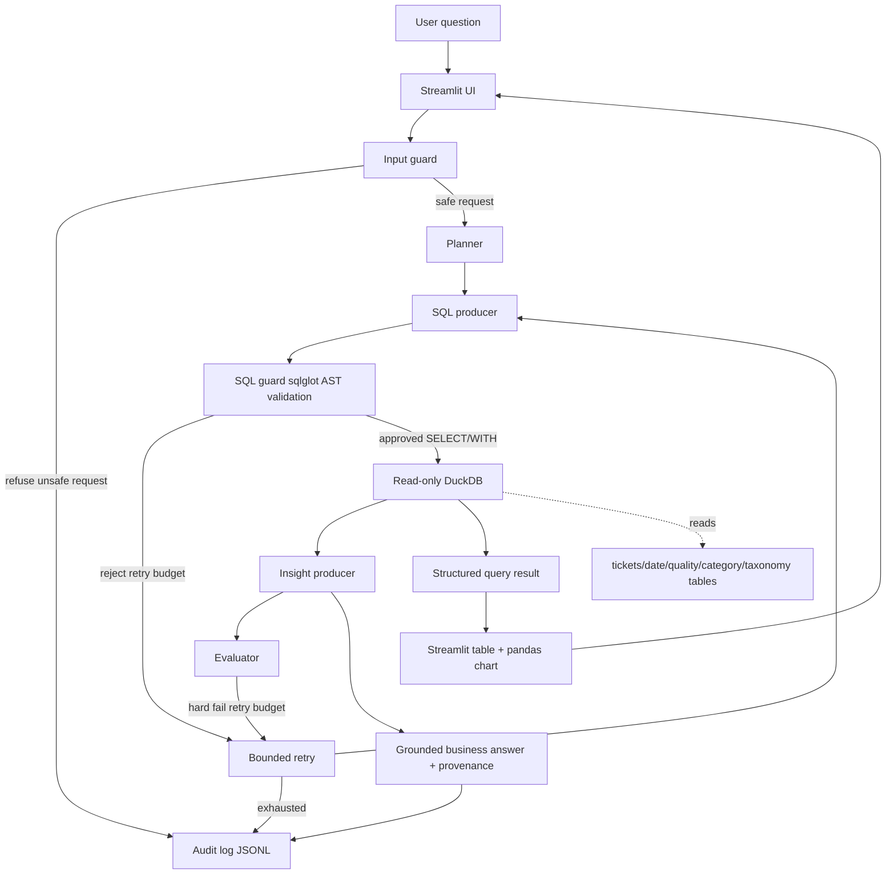
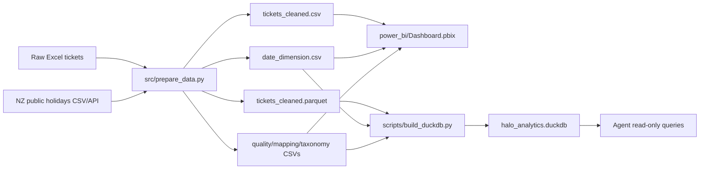
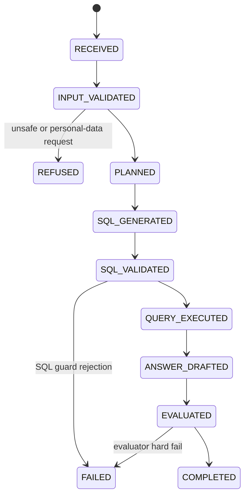
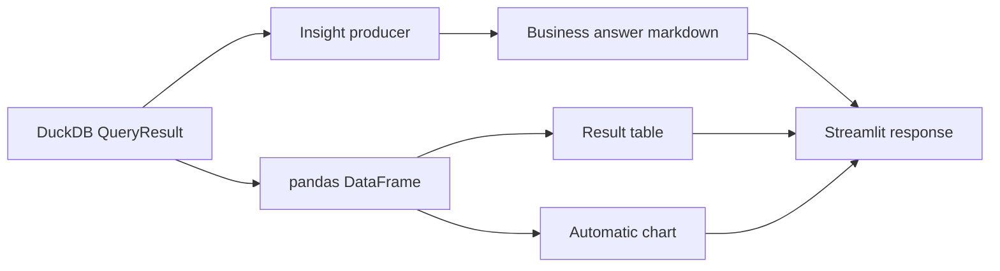

# Halo IT Data & AI Assessment Design

## Current Deliverables

The repository now contains four assessment deliverables:

- Part 1 data preparation: reproducible cleaning and external NZ public-holiday enrichment.
- Part 2 Power BI dashboard: `power_bi/Dashboard.pbix` for 2024-2025 support performance reporting.
- AI analytics agent: a Docker-ready, read-only Streamlit + DuckDB agent with SQL guardrails, Pydantic-validated fake/Groq modes, bounded retry, provenance, evaluator scoring, and JSONL audit logging.
- Written review response: `docs/assessment_review_response.md`.

## Assessment Fit

| Assessment area | Implementation | Current status |
| --- | --- | --- |
| Source, combine, prepare | Python pipeline combines the synthetic TechSolve workbook with NZ public holidays, preserves source fields, adds reporting taxonomy, quality flags, SLA calculations, and dashboard-ready outputs. | Complete |
| Visualise | Power BI dashboard artifact is committed at `power_bi/Dashboard.pbix`; processed CSV/Parquet and date/quality/taxonomy files support 2024-2025 ticket, status, resolution, and holiday analysis. | Complete artifact; requires final manual visual QA in Power BI Desktop |
| AI agent | Streamlit + DuckDB agent answers operational questions with guarded SQL, structured results, charts, business interpretation, audit logs, and fake/Groq runtime modes. | Complete and locally verified |
| Written review | Separate review document answers the six required practical assessment questions. | Complete |

## Final Architecture



## Data Flow



## Power BI Dashboard Layer

The dashboard artifact is stored as `power_bi/Dashboard.pbix`. It is intended to
use the processed 2024-2025 reporting dataset, including issue taxonomy, status,
resolution time, SLA metrics, and public-holiday context.

The dashboard should be opened once in Power BI Desktop before final submission
to confirm refresh paths, page rendering, filters, and interactions. PBIX is a
binary format, so the automated Python and Docker checks can confirm the file is
present and committed but cannot inspect every visual layout detail.

## Agent Request State



## Answer And Visualization Layer

The agent keeps the raw query result as structured rows in `AgentResponse.query_result`
instead of only returning prose. That lets the same answer support three review modes:

- Markdown answer: finding, evidence table, business interpretation, possible drivers,
  recommended actions, caveats, and provenance.
- Streamlit table: full result rows from DuckDB, capped by the SQL producer and guardrails.
- Streamlit chart: pandas-backed line chart for monthly trends and bar chart for
  categorical comparisons such as team SLA, holiday windows, service areas, and categories.



The richer answer intentionally uses cautious language. It can suggest plausible
operational drivers such as case mix, backlog, routing, staffing, holiday cover,
release cycles, or data-quality defects, but it does not state causal conclusions
unless the SQL result directly supports them.

## Audit Logging

Every call to `AnalyticsOrchestrator.answer()` writes one `structlog`-rendered JSONL record through `agent/audit_log.py`.

Default paths:

- Local: `.runtime/agent_queries.jsonl`
- Docker: `/tmp/halo-agent-logs/agent_queries.jsonl`

Each record includes:

- `request_id` and `trace_id`
- redacted question text and question hash
- state and refusal reason
- generated SQL and validated SQL
- validation risk flags
- planner, SQL producer, insight producer, and evaluator type
- prompt versions
- retry count
- query ID, dataset version, rows analysed, filters, confidence
- evaluator quality score, hard-fail flag, and issues
- per-role token usage, estimated cost, value per 1k tokens, value per USD
- result row/cell counts and per-stage latency

Question text is redacted for common API-key and email patterns. SQL is logged in full because it is generated from the approved schema and is required for auditability.

## Security Controls

- Input guard refuses personal-data, secret extraction, prompt extraction, arbitrary filesystem, web, and destructive SQL requests.
- SQL guard permits only one approved analytical statement.
- SQL guard rejects mutation, admin commands, external file/network functions, unapproved tables/columns, system tables, and wildcard projections.
- SQL guard caps joins, CTE count, subquery depth, result rows, and result cells.
- Runtime DuckDB connections are opened with `read_only=True`.
- The schema allowlist excludes direct customer names, customer emails, billing contacts, and unrestricted resolution notes.
- Docker runs as a non-root user; Compose uses read-only filesystem, dropped capabilities, no new privileges, and tmpfs `/tmp`.
- `.env`, `.runtime`, DuckDB files, eval reports, virtualenvs, and build metadata are ignored.

## Residual Risks And Final Checks

- Power BI visual layout is a manual QA item because PBIX internals are not part of the automated test suite. The committed `power_bi/Dashboard.pbix` is the saved dashboard artifact for submission.
- A limited owner-approved live Groq smoke test was completed successfully. Broader live evaluation remains out of scope for this assessment; offline fake-mode and mocked Groq integration tests are the default verification path.
- Holiday enrichment currently uses national NZ public holidays. Regional anniversary days or weather data would be reasonable future enhancements if more operational context is needed.
- The source data contains substantial category and SLA inconsistencies. The pipeline exposes these with flags instead of silently deleting or overwriting the records.
- The v1 evaluation runner does not yet fully assert every configured `expected_intent`, `expected_dimensions`, `required_metrics`, and `required_filters`; those checks are a future enterprise evaluation enhancement.

## Performance Evaluation

Current deterministic fake-mode checks:

- Data preparation: `python src/prepare_data.py`
- DuckDB build: `python scripts/build_duckdb.py`
- Unit/integration/security tests: `pytest`
- SQL and style checks: `ruff check .`, `ruff format --check .`
- Type checks: `mypy agent`
- Offline smoke eval suite: `python -m agent.evals.run --suite smoke`
- Offline security eval suite: `python -m agent.evals.run --suite security`
- Static security scan: `bandit -r agent scripts`
- Dependency vulnerability scan: `pip-audit`
- Container build check: `docker build --tag halo-it-agent:ci .`

The eval suite contains normal operational questions plus refusal/security cases. The evaluator computes:

```text
quality_score =
  0.25 correctness
+ 0.20 groundedness
+ 0.15 completeness
+ 0.10 relevance
+ 0.10 safety
+ 0.08 caveat_quality
+ 0.07 actionability
+ 0.05 cost_efficiency
```

Value metrics:

```text
value_score = quality_score * task_completion * user_feedback_factor
value_per_1k_tokens = 1000 * value_score / max(total_tokens, 1)
value_per_usd = value_score / max(estimated_cost_usd, 0.000001)
```

## Notable Implementation Decisions

- Use structured SQL over vector search because the dataset is tabular and analytical questions require aggregation and filtering.
- Keep fake mode as the default unless `AGENT_LLM_MODE=groq`, so CI and demos never call live Groq accidentally.
- In Groq mode, validate every role output with Pydantic and still approve SQL locally before execution.
- Preserve Part 1 source fields and add reporting fields instead of overwriting raw values.
- Log generated SQL for every successful analytical request to make answers auditable.
- Keep logs outside Git and use redaction for potentially sensitive question text.
- Declare `openpyxl` and `requests` as first-class runtime dependencies because CI must read the source Excel workbook and the project includes an optional public-holiday API refresh path.
- Keep `pyarrow` and `pytest` on audited safe ranges so the generated Parquet output, CI test runner, and dependency scan remain submission-ready.
